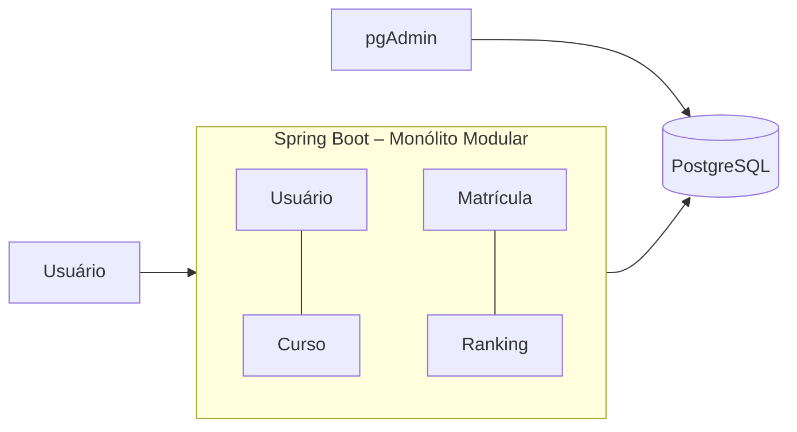

# Registro Arquitetural – B1 / Desafio 1

## RF
RF-RANK-01 – disponibilizar ranking considerando cursos concluídos e moedas.

## RNF / FURPS+
- Manutenibilidade: mudanças de uma capacidade devem afetar o mínimo possível as demais.
- Testabilidade: fronteiras internas precisam facilitar testes por capacidade.
- Desempenho/Escalabilidade: reconhecer que Ranking pode crescer de forma diferente, sem antecipar microsserviços.

## ASRs prioritários
1. Evolução frequente e localizada do Ranking.
2. Crescimento desigual da carga de Ranking.
3. Necessidade de fronteiras explícitas para futura decomposição, se houver evidência.

## RPCs
Java 17; Spring Boot; PostgreSQL; Docker; um único processo e um único deploy nesta alternativa.

## ADR-001 – Evoluir para Monólito Modular
**Contexto:** a organização horizontal torna capacidades espalhadas por controller/service/repository/domain.  
**Alternativas:** manter camadas; organizar por módulos de negócio; extrair serviço de Ranking.  
**Decisão:** agrupar o código em módulos `usuario`, `curso`, `matricula` e `ranking`, mantendo subcamadas internas.  
**Consequências:** maior coesão e fronteiras mais visíveis sem custo de rede/distribuição; ainda não há escala nem deploy independentes em runtime.

## C4 – Container

## Evidência
`GET /api/ranking` permanece igual externamente, mas API, aplicação e persistência do Ranking ficam agrupadas em `ranking/`.
