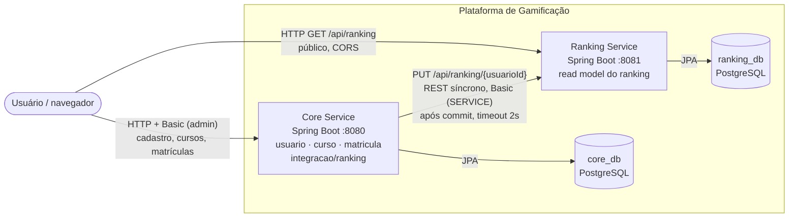
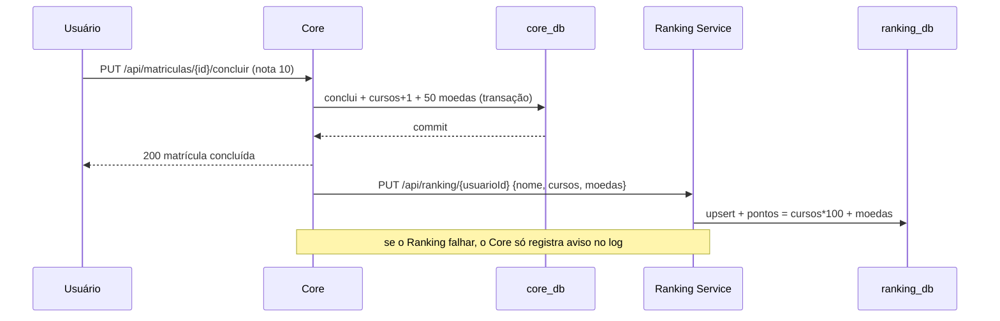

# Registro Arquitetural — B1 Architecture Lab

Registro vivo e cumulativo das decisões arquiteturais da plataforma de Gamificação para
Educação Continuada. Cada desafio segue a mesma trilha rastreável:

**RF → RNF → ASR + RPC → Alternativas/trade-offs → ADR → C4 → Evidência**

| Item | Valor |
|---|---|
| Equipe | _preencher (nomes e RAs)_ |
| Repositório | https://github.com/Ntanzi07/B1_Desafio_microService |
| Ponto de partida | Exemplo da professora: Monólito Modular (`usuario`, `curso`, `matricula`, `ranking`) |

---

## Matriz cumulativa de ASRs

Atualizada a cada desafio. Só entram RNFs que alteram estrutura, comunicação, dados,
implantação ou operação.

| ID | Desafio | ASR | Impacto arquitetural | Decisão relacionada |
|---|---|---|---|---|
| ASR-01 | 1 | Escalabilidade do Ranking | Ranking precisa escalar sozinho → separa **implantação** (processo e container próprios) | ADR-001 |
| ASR-02 | 1 | Desempenho de leitura do Ranking | Leitura frequente não pode depender de JOIN nas tabelas do Core → **dados** próprios em formato de leitura (read model) | ADR-001 |
| ASR-03 | 1 | Complexidade operacional (limite) | Mais serviços = mais coisas para operar → decomposição **seletiva**: só o Ranking sai, o resto fica no Core | ADR-001 |
| — | 2–6 | _a preencher_ | | |

---

## Desafio 1 — Drivers e evolução do Core

> **Nota:** o exemplo da professora resolveu este desafio com **Monólito Modular (B)**.
> Esta equipe escolheu a alternativa **(C) decomposição seletiva**, extraindo apenas o
> Ranking. A comparação entre B e C está nas alternativas e no ADR-001.

### 1. RF

| ID | Requisito | Onde fica após a decisão |
|---|---|---|
| RF01 | Ranking de usuários por pontuação (100 por curso concluído com aproveitamento + moedas) | **Ranking Service** |
| RF02 | Conquistas/recompensas: conclusão de curso, créditos, moedas, plano Premium | Core |
| — | Evolução das funcionalidades existentes (usuários, cursos, matrículas) | Core |

Regra de moedas adotada neste desafio: concluir um curso com **nota 10** rende **50 moedas**.

### 2. RNF (FURPS+)

| RNF | FURPS+ | Situação no cenário (1.000 → 100.000 usuários) |
|---|---|---|
| Manutenibilidade | Supportability | Regras de gamificação mudam com frequência |
| Desempenho | Performance | Ranking é consultado com muito mais frequência do que é alterado |
| Escalabilidade | Performance / Supportability | **O ranking cresce mais que as outras funcionalidades** |
| Testabilidade | Supportability | Cada capacidade precisa ser testada isoladamente |
| Complexidade operacional | + (restrição de operação) | Equipe pequena para operar o sistema |

### 3. ASR (máx. 3)

1. **Escalabilidade** — como o Ranking cresce mais que o resto, ele precisa poder ganhar
   réplicas e recursos sem escalar Usuário, Curso e Matrícula junto; isso muda a
   **implantação** (processo e container próprios).
2. **Desempenho de leitura** — consultar o ranking não pode exigir JOIN entre `assinaturas`
   e `usuarios` a cada acesso; isso muda os **dados** (tabela própria, já com os pontos
   calculados e indexados).
3. **Complexidade operacional** — cada serviço novo exige build, deploy, banco e
   monitoramento; isso limita a **estrutura**: só a capacidade com ASR forte é extraída.

Manutenibilidade e testabilidade continuam importantes, mas **não** são ASRs aqui: o
Monólito Modular já as atende sem mudar a implantação.

### 4. RPC

| RPC | Efeito na decisão |
|---|---|
| Core permanece em Java/Spring Boot | Ranking Service também em Spring Boot (mesma stack, sem curva nova) |
| Equipe de 6 desenvolvedores | Permite operar **um** serviço a mais; não comporta quebrar tudo em microsserviços |
| Banco relacional e legado da AC1 | PostgreSQL nos dois serviços; endpoints do Core mantidos |
| Docker / Docker Compose | Ambiente dos dois serviços sobe com um comando |

### 5. Decisão do Tech Lead

- **Quais RNFs viram ASR?** Escalabilidade e desempenho de leitura do Ranking, com a
  complexidade operacional como limite.
- **Há necessidade de escala/deploy independente?** Para o Ranking, sim: é a única
  capacidade com crescimento desproporcional no cenário. Para Usuário, Curso e Matrícula,
  não.
- **A complexidade distribuída é justificável?** Só para essa fronteira. Por isso a
  decomposição é **seletiva**: um serviço extraído, e não uma arquitetura de microsserviços.

### 6. Alternativas e trade-offs

| Critério | (A) Monólito em Camadas | (B) Monólito Modular | (C) Decomposição seletiva (escolhida) |
|---|---|---|---|
| Escalar só o Ranking | Não | Não | **Sim** |
| Deploy independente do Ranking | Não | Não | **Sim** |
| Fronteiras de código | Fracas (por camada técnica) | Claras (por módulo) | Claras e **físicas** (outro processo) |
| Dados do Ranking | JOIN nas tabelas do Core | JOIN nas tabelas do Core | Tabela própria (read model) |
| Consistência | Imediata | Imediata | **Eventual** (o Ranking recebe a mudança após o commit) |
| Complexidade operacional | Baixa | Baixa | **Maior**: 2 APIs, 2 bancos, rede, credencial |
| Falha | Tudo cai junto | Tudo cai junto | Ranking fora do ar não derruba o Core |

**Por que não B?** B é a escolha mais barata e foi a da professora. Ela organiza o código,
mas o Ranking continua no mesmo processo e no mesmo banco: não escala nem é implantado
sozinho, que é justamente o ASR-01. **Por que não microsserviços para tudo?** O ASR-03 e a
equipe de 6 pessoas não justificam distribuir capacidades que não têm a mesma pressão.

### 7. ADR-001 — Extrair o Ranking como serviço com banco próprio

**Status:** aceito.

**Contexto:** no cenário de 100.000 usuários, o Ranking cresce mais que as outras
funcionalidades e é dominado por leitura. No monólito, ele lia `assinaturas` + `usuarios`
com JOIN, no mesmo processo e no mesmo banco do Core.

**ASRs/RPCs:** ASR-01 escalabilidade, ASR-02 desempenho de leitura, ASR-03 complexidade
operacional; Java/Spring Boot, equipe de 6, PostgreSQL, Docker.

**Alternativas:** (A) camadas; (B) monólito modular; (C) extrair o Ranking. Dentro de (C),
dois modos de dados foram comparados:
- **C1 — Ranking lê o banco do Core** (banco compartilhado): rejeitada, porque acopla os dois
  serviços pelo esquema da tabela e anula o deploy independente;
- **C2 — Ranking com banco próprio, alimentado pelo Core** (database-per-service): escolhida.

**Decisão:**
1. `ranking-service` é um projeto Spring Boot separado (porta 8081), com PostgreSQL próprio
   (`ranking-postgres`, banco `ranking_db`).
2. O Ranking guarda um **read model** (`ranking_entries`): `usuarioId`, `nome`,
   `cursosConcluidos`, `moedas` e `pontos` já calculado, com índice em `pontos`.
3. Contrato entre os serviços: `PUT /api/ranking/{usuarioId}`, **idempotente** (cria ou
   atualiza). O `@Id` é o próprio id do usuário no Core. Repetir a chamada não duplica dados.
4. O Core publica `RankingDadosAlteradosEvent` ao criar usuário e ao concluir matrícula com
   aproveitamento; o `RankingSyncListener` envia o PUT **somente após o commit**
   (`@TransactionalEventListener(AFTER_COMMIT)`), com timeout de 2s.
5. Segurança: `GET /api/ranking/**` é público; `PUT`/`DELETE` exigem credencial de serviço
   (HTTP Basic, papel `SERVICE`), vinda do `.env` e nunca escrita no código. CORS liberado só
   para `GET` a partir do front do Core (`http://localhost:8080`).

**Consequências:**
- (+) O Ranking escala e é implantado sem tocar no Core; consultas leem uma tabela própria e
  indexada, sem JOIN.
- (+) Falha isolada: se o Ranking cair, matrículas continuam sendo concluídas no Core.
- (+) Nenhum serviço lê o banco do outro.
- (−) **Consistência eventual**: se o Ranking estiver fora do ar, a mudança é perdida e o
  ranking fica desatualizado até a próxima alteração daquele usuário. Não há reenvio
  automático — esse é o ponto de partida do **Desafio 4** (eventos/mensageria).
- (−) Dado duplicado (nome, cursos e moedas existem nos dois bancos).
- (−) Todo ponto do Core que altera cursos ou moedas precisa publicar o evento.
- (−) Usuários criados antes da integração não aparecem no ranking (falta carga inicial).
- (−) Operação maior: 2 APIs, 2 bancos, 2 pgAdmin, credencial compartilhada.

### 8. C4 — Container

Fluxo crítico (conclusão de matrícula):

O C4 Component do Core fica para o **Desafio 2**. O módulo `integracao/ranking` é a
primeira fronteira que deverá aparecer nele.

### 9. Evidência (mini-lab)

Roteiro completo e resultados em [`docs/evidencias/desafio-1.md`](../evidencias/desafio-1.md).

**Dependências antes/depois** (o que o enunciado pede comparar):

| Elemento | Antes (Monólito Modular) | Depois (Ranking Service) |
|---|---|---|
| Fonte dos dados do ranking | `RankingRepository extends JpaRepository<Assinatura, Long>` | `RankingRepository extends JpaRepository<RankingEntry, Long>` |
| Consulta | `join fetch a.usuario`, pontos calculados na query | `findAllByOrderByPontosDesc...`, pontos já gravados |
| Dependência de código do Ranking | `com.exemplo.usuario.usuario.domain.Assinatura` (domínio do Core) | Nenhuma classe do Core |
| Dependência do Core para o Ranking | Nenhuma (mesmo processo) | Só `integracao/ranking/RankingClient` (HTTP) |
| Banco | `usuario_db` compartilhado | `core_db` e `ranking_db` separados |
| Processo / deploy | 1 | 2 (`core-api`, `ranking-api`) |

---

## Desafios 2 a 6

_A preencher, seguindo a mesma trilha e atualizando a matriz de ASRs._

## Síntese para a AF

_A preencher ao final do B1: quais decisões seguem para a PoC da Avaliação Final._
