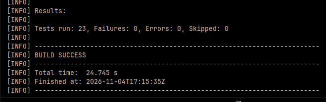
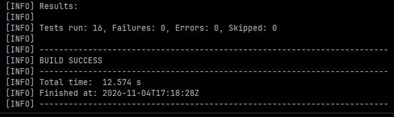

# Evidência — Desafio 1 (Ranking como serviço)

Hipótese testada: **o Ranking pode viver em outro processo, com banco próprio, sem que o
Core dependa dele para funcionar — ao custo de consistência eventual.**

Pré-requisito: `.env` na raiz (copiar de `.env.example`) e `docker compose up --build -d`.

| # | Teste | Como | Esperado | Resultado observado |
|---|---|---|---|---|
| 1 | Os 2 serviços sobem separados | `docker ps` | `core-api`, `ranking-api`, `core-postgres`, `ranking-postgres` em pé |  |
| 2 | Novo usuário entra no ranking | Criar usuário no front (`:8080/index.html`) e clicar em "Atualizar ranking" | Usuário com 0 pontos |  |
| 3 | Conclusão atualiza o ranking | Matricular e concluir com nota 10 | 150 pontos (100 + 50 moedas) |  |
| 4 | PUT exige credencial | `PUT /api/ranking/1` no Swagger `:8081` sem Authorize | HTTP 401 | Coberto por teste automatizado: `putSemCredencialDevolve401`, `putComSenhaErradaDevolve401`, `deleteSemCredencialDevolve401` (`RankingApiIntegrationTest`) — passou |
| 5 | PUT é idempotente | Mesmo PUT (autorizado) duas vezes | Mesma linha, mesmos pontos | Coberto por teste automatizado: `putRepetidoNaoDuplicaNemSomaPontos` (3 PUTs → 1 linha, 230 pontos) e `deleteAutorizadoEIdempotente` — passou |
| 6 | Falha isolada | `docker stop ranking-api` e concluir outra matrícula | Core responde 200; log do Core mostra `Nao foi possivel atualizar o ranking` |  |
| 7 | Consistência eventual | `docker start ranking-api` e consultar o ranking | Usuário do teste 6 com pontos **antigos** (mudança perdida) |  |

## Testes automatizados

Executados com `mvn clean test` (imagem `maven:3.9.9-eclipse-temurin-17`), sem banco real:
domínio e services com Mockito; API do Ranking com MockMvc + H2.

### Ranking Service — 23 testes, 0 falhas



| Classe | Testes | Decisão do ADR-001 que comprova |
|---|---|---|
| `RankingEntryTest` | 6 | Pontos = cursos × 100 + moedas, calculados no read model; atualizar **substitui** em vez de somar |
| `RankingServiceTest` | 5 | Upsert: cria se não existe, atualiza a mesma linha se existe |
| `RankingApiIntegrationTest` | 12 | GET público; **PUT/DELETE sem credencial → 401**; **3 PUTs iguais = 1 linha** (idempotência); 400/404; ordenação; **CORS** só para `localhost:8080` |

### Core — 16 testes, 0 falhas



| Classe | Testes | Decisão do ADR-001 que comprova |
|---|---|---|
| `MatriculaTest` | 6 | Nota ≥ 7 = aproveitamento; nota 10 = moedas |
| `AssinaturaTest` | 5 | Cursos, créditos, moedas e Premium continuam no Core |
| `MatriculaServiceTest` | 3 | Conclusão **publica o evento** com a foto certa; nota baixa não publica |
| `RankingSyncListenerTest` | 2 | **Ranking fora do ar não derruba o Core** (exceção não propaga) |

Comandos úteis:

```
docker compose logs core --tail 30
docker stop ranking-api
docker start ranking-api
curl.exe http://localhost:8081/api/ranking
```

Conclusão: _preencher após os testes. O teste 7 é o motivo do Desafio 4._
